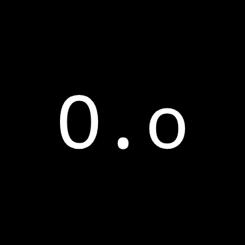

# TUKO TAKO

  

A fast, sharp-cornered puzzle game in the style of **Puyo Puyo**. Pair up
matching square blocks — match **4 or more** in a row to pop them, trigger
chains for huge points, and beat your high score!

**Play it at:** <https://fakerhog15.github.io/tuko-tako/>

## Gameplay

- Blocks fall in pairs of two.
- Swap between 6 bold colors: **blue, green, red, black, white, yellow**.
- Match 4+ blocks orthogonally to clear them.
- Cleared blocks fall away and chain into new matches.
- Build chains to multiply your score.
- Game over when blocks reach the top.

## Controls

| Key                        | Action        |
| -------------------------- | ------------- |
| <kbd>&larr;</kbd> <kbd>&rarr;</kbd> | Move left / right |
| <kbd>&uarr;</kbd> or <kbd>X</kbd>   | Rotate clockwise |
| <kbd>Z</kbd>               | Rotate counter-clockwise |
| <kbd>&darr;</kbd>          | Soft drop      |
| <kbd>Space</kbd>           | Hard drop      |
| <kbd>C</kbd>               | Hold piece     |

On-screen touch buttons are included for mobile play.

## Presentation

- One-canvas layout with a **piece preview queue** (next 3) and a **hold** slot.
- **Ghost piece** drop indicator and active-column highlight.
- Particle bursts, chain flashes, leveling and a level progress bar.
- **CRT + RF filter** (WebGL): replicates a `crt-geom` look (screen curvature,
  aperture-grille shadow mask, scanlines, vignette) together with a
  `crt-guest-advanced` NTSC/RF look (color fringing, animated RF static,
  horizontal ringing echo and phosphor afterglow). Toggle it with the
  **DISPLAY** button in-game; it silently falls back to a plain render if WebGL
  is unavailable.

## Sound

- **Main Menu** — *Mario Kart 7 Soundtrack - Main Menu*
- **SNES Rainbow Road** — *Mario Kart 7 Soundtrack - SNES Rainbow Road*
- Cycle between tracks with the **MUSIC** button in-game.

Switch tracks anytime during play. All in-game sound effects (move, rotate,
drop, hold, clear, chain, game over) are synthesized in the browser with a
16-bit **SNES-style** Web Audio engine (pulse + sub-oscillator tones and a
band-limited noise channel).

## Credits

- Music: *Mario Kart 7* soundtrack (Nintendo)
- Font: Iosevka Nerd Font Mono
- Built with plain HTML5 Canvas + JavaScript — no dependencies.